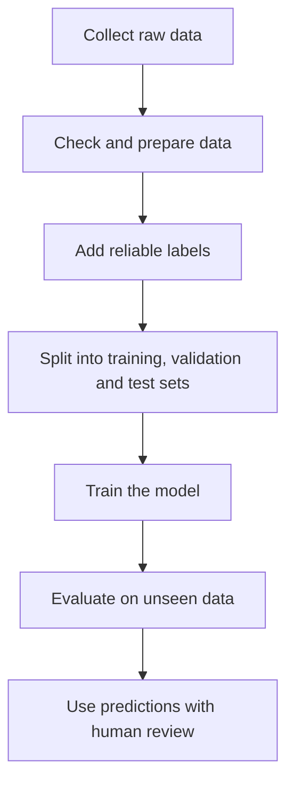

# W04 – Understanding Deep Learning

This folder contains my Week 04 AI Literacy Layer work. It explains how data is prepared, how machine learning differs from deep learning, the parts of a neural network, and how a network learns. The final case study uses semiconductor image inspection as a proposed engineering example.

## Files

1. [Data Behind Deep Learning](data_behind_deep_learning.md)
2. [Machine Learning vs Deep Learning](ml_vs_deep_learning.md)
3. [Neural Network Diagram](neural_network_diagram.md)
4. [How Neural Networks Learn](how_neural_networks_learn.md)
5. [TensorFlow Playground Experiment](playground_experiment.md)
6. [Engineering Case Study](engineering_case_study.md)
7. [Sources](sources.md)
8. [Reflection](reflection.md)

## Overall workflow

The Playground experiment and personal reflection sections include places to enter observations after completing the activity. I have not invented experiment results or screenshots.
