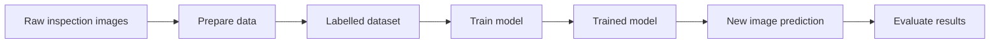

# Week 04 — Data & Deep Learning Foundations

**Theme:** Data preparation, neural networks and learning  
**Example throughout:** A proposed system that examines semiconductor inspection images and predicts whether an image may contain a defect.

> Learning portfolio note: This repository is a study explanation and proposed engineering workflow. The Playground experiment section contains a recording template and an illustrative observation pattern; replace it with your own settings, screenshots and observations after performing the experiment. Do not present illustrative results as measured results.

## Learning goals
- Explain how raw images become numerical model inputs.
- Compare rule-based systems, traditional machine learning and deep learning.
- Trace information through a neural network.
- Explain forward pass, loss, backpropagation, parameter updates and evaluation.
- Consider when deep learning is appropriate for an engineering problem.

## Folder contents
| File | What it contains |
|---|---|
| `data_behind_deep_learning.md` | Data preparation, quality, labels, splits and flow diagram |
| `ml_vs_deep_learning.md` | AI/ML/DL relationship and comparison table |
| `neural_network_diagram.md` | Network architecture diagram and input-to-output example |
| `how_neural_networks_learn.md` | Training cycle, loss, backpropagation and generalisation |
| `playground_experiment.md` | Experiment procedure, log template and interpretation |
| `engineering_case_study.md` | Proposed semiconductor inspection case study |
| `sources.md` | Learning resources and evidence notes |
| `reflection.md` | Reflection prompts with editable first-person draft |

## Main workflow at a glance

## Important limitation
A model output is a prediction, not proof that a physical defect exists. Production use requires representative data, independent evaluation, defined acceptance criteria and engineering/human review.
