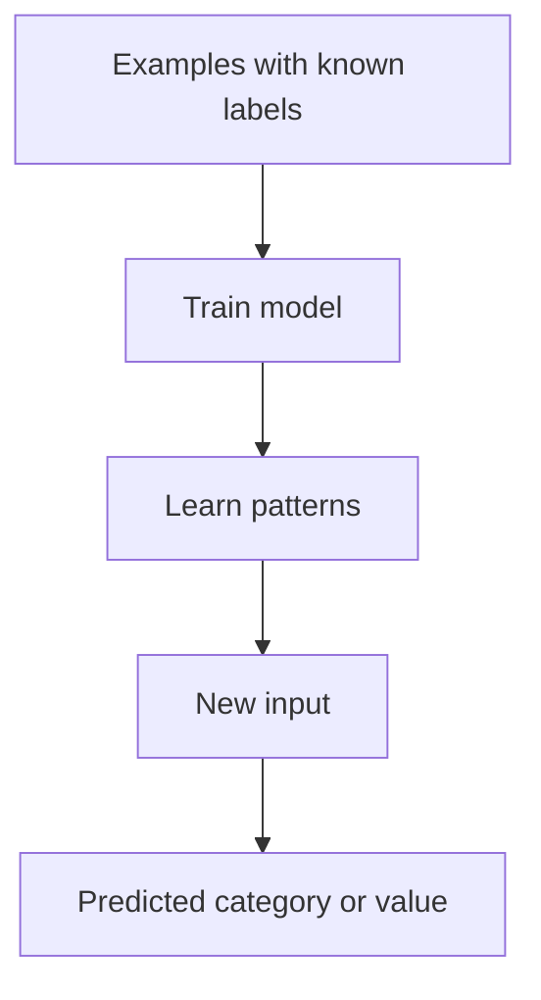
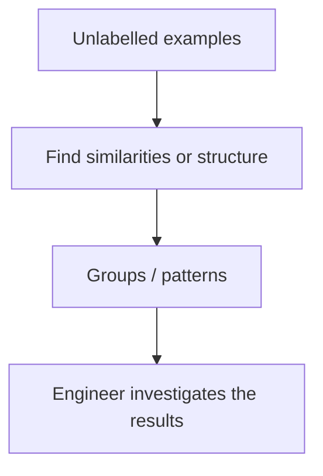
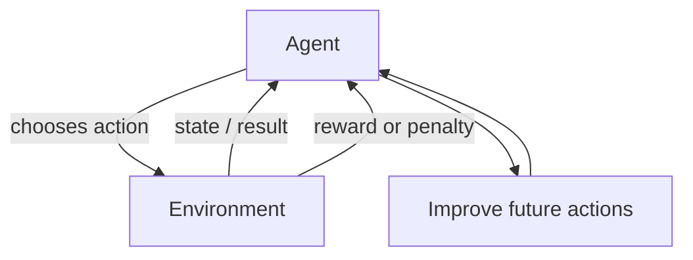
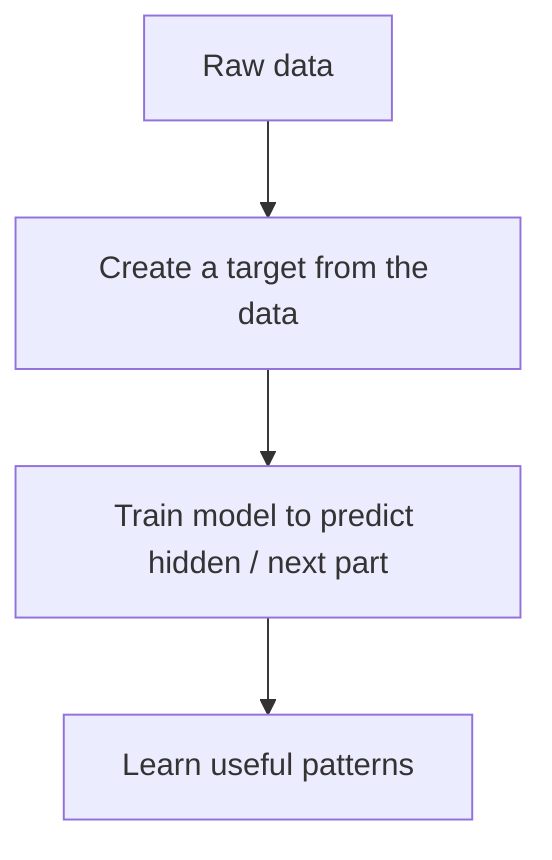

# Mission 3 — Understand the Main ML Approaches

## 1. Comparison table

| Approach | Training signal | What it learns / produces | Example | One limitation |
|---|---|---|---|---|
| Supervised learning | Examples with known labels or target values | Predicts a category or number | Predict timing pass/fail from historical runs | Needs reliable labels |
| Unsupervised learning | Data without supplied target labels | Finds groups or patterns | Group similar physical-design runs | Groups may not have clear engineering meaning |
| Reinforcement learning | Rewards or penalties from actions | Learns a policy for choosing actions | Explore design settings and reward good PPA outcomes | Reward design and safe exploration can be difficult |
| Self-supervised learning | Targets created from the data itself | Learns by predicting hidden or next parts of input | Predict a hidden part of a sequence | The pretext task may not teach everything needed for a later task |

## 2. Supervised learning diagram

## 3. Unsupervised learning diagram

## 4. Reinforcement learning diagram

## 5. Self-supervised learning diagram

## 6. When could each be suitable?

- **Supervised:** When a clear target exists and enough trustworthy historical examples are available.
- **Unsupervised:** When the goal is to explore data and discover groups or unusual patterns without existing labels.
- **Reinforcement:** When a sequence of actions affects later outcomes and a meaningful reward can be defined.
- **Self-supervised:** When much raw data is available and training targets can be generated from that data.

Self-supervised learning is related to unsupervised learning because it can start without human-provided labels. However, it explicitly creates a prediction target from the input. In many modern AI contexts, it is treated as a distinct training approach because its learning signal and objective are specific.

## Sources
- Google, [What is Machine Learning?](https://developers.google.com/machine-learning/intro-to-ml/what-is-ml)
- Google, [Supervised Learning](https://developers.google.com/machine-learning/intro-to-ml/supervised)
- Google, [Machine Learning Crash Course](https://developers.google.com/machine-learning/crash-course/)
