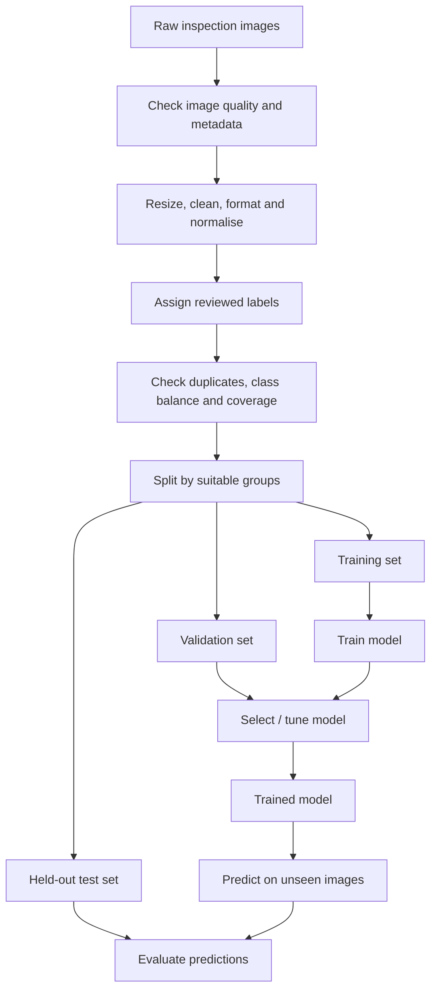

# Mission 1 — Data Behind Deep Learning

## 1. From raw images to numerical inputs
A digital image is stored as a grid of pixels. Each pixel contains a numerical intensity value (for a grayscale image) or multiple channel values (commonly red, green and blue for a colour image). A neural network receives numbers, not a human-style visual description.

For example, a small grayscale image can be represented as a matrix:

```text
[  0  12  35  40 ]
[  5  80 120  45 ]
[  2  75 200  30 ]
[  0  10  25  15 ]
```

A real inspection image may contain many more pixels. The matrix is converted into a tensor (a structured numerical array) with dimensions such as height × width × channels.

## 2. Data preparation
- **Resizing:** make image dimensions consistent when the model expects a fixed input size. Resizing must not erase small defects.
- **Cleaning:** identify corrupted, unreadable or irrelevant images.
- **Formatting:** use a consistent image format, channel order and tensor shape.
- **Normalisation:** scale numerical pixel values to a suitable range, for example from 0–255 to 0–1. This can make numerical optimisation more stable.
- **Deduplication:** identify duplicate or near-duplicate images so that copies do not leak across dataset splits.

Preparation choices should be documented because they can change what information the model sees.

## 3. Labels and examples
An **image** is the input. A **label** is the target answer associated with that input. In a binary example:
- `defect` — an image reviewed and labelled as containing a defect.
- `no_defect` — an image reviewed and labelled as not containing the target defect.

Labels should follow a clear definition and, where appropriate, a review process. Ambiguous cases should not be silently forced into a class.

## 4. Data quality
- **Incorrect labels:** teach the model the wrong association.
- **Duplicate images:** can make evaluation look better than real-world performance if similar copies occur in both training and test sets.
- **Noisy or blurred images:** may hide relevant visual details.
- **Missing examples:** leave the model unprepared for certain defect types, process conditions or image qualities.
- **Inconsistent capture conditions:** can cause a model to learn lighting or equipment differences instead of defect characteristics.

## 5. Representativeness and class imbalance
If 9,900 images show `no_defect` and only 100 show `defect`, a model that predicts `no_defect` every time would achieve 99% accuracy while missing every defect. Therefore, accuracy alone is not enough. Inspect class-wise recall, precision, confusion matrix and the cost of false negatives and false positives. Consider collecting more examples or using appropriate imbalance-handling methods, then validate the effect on an untouched test set.

## 6. Train, validation and test splits
- **Training set:** used to learn model parameters.
- **Validation set:** used during development to compare configurations and tune choices.
- **Test set:** held back for a final evaluation after development decisions are complete.

Do not repeatedly use the test set to choose model settings. That makes the test set part of the development process and can produce an overly optimistic estimate. For image data, split by wafer, lot, device, capture session or other meaningful group where appropriate; random image-level splitting may put near-duplicates or related images in both sets.

## Required flow diagram



## Two data-related problems and their effects
1. **Incorrect defect labels:** the model may learn misleading visual patterns and repeat labelling mistakes in its predictions.
2. **Unrepresentative or imbalanced data:** rare defect types may be missed, even when overall accuracy appears high.

**Key point:** model quality is limited by the quality, coverage and split design of the data.
