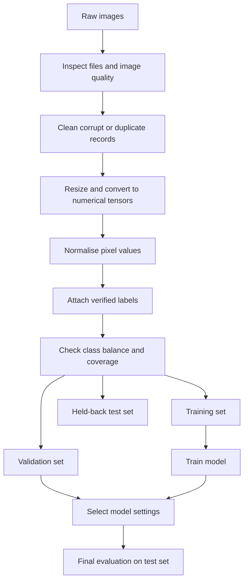

# Mission 1 – Data Behind Deep Learning

## 1. What is the data?

A deep-learning model learns patterns from examples. For an image task, the examples are images. A digital image is made of small picture elements called **pixels**. Each pixel stores a number representing its brightness or colour.

- A grayscale image usually stores one intensity value per pixel.
- An RGB image stores three values per pixel: red, green and blue.
- A group of numerical values arranged in dimensions is commonly represented as a **tensor**.

For example, an RGB image with a height of 128 pixels and a width of 128 pixels can be represented by a tensor with dimensions `128 × 128 × 3`.

## 2. Preparing image data

Before training, image data normally needs to be checked and prepared. Common steps include:

1. **Collect:** gather images from a suitable and permitted source.
2. **Inspect:** check that files open correctly and that images are relevant.
3. **Clean:** remove corrupt files and investigate duplicates or incorrect labels.
4. **Resize:** make image dimensions consistent when the model requires a fixed input size.
5. **Format:** convert images into a numerical format the training software can use.
6. **Normalise:** scale pixel values to a useful range, often from 0 to 1.
7. **Label:** attach the correct target class or annotation to each example.

Preparation must not remove important information. For example, resizing a tiny defect until it disappears would damage the usefulness of the training data.

## 3. Labels and data quality

A **label** tells the model the expected answer for a training example. In a simple inspection task, labels might be `defect` and `no_defect`. In a more detailed task, labels could identify scratch, crack, stain or missing feature.

Good labels should be consistent and checked by people who understand the inspection task. Incorrect labels teach the model the wrong relationship. Images should also represent the real conditions in which the model will be used, such as different lighting, camera settings, product batches and defect appearances.

## 4. Class imbalance

Class imbalance occurs when one class has many more examples than another. For example, a dataset might contain 9,500 normal images and only 500 defect images. A model could achieve high overall accuracy by predicting `normal` most of the time, while missing defects. Therefore, class counts and class-specific measures such as recall and precision should be checked. Possible responses include collecting more minority-class examples, using suitable class weights, or applying carefully designed sampling methods.

## 5. Training, validation and test data

- **Training set:** examples used to adjust the model's weights.
- **Validation set:** examples used during model development to compare settings and monitor overfitting.
- **Test set:** held-back examples used for a final evaluation after development choices are complete.

The test set should not be repeatedly used to tune the model. For manufacturing images, a random image split can be misleading if near-duplicate images from the same wafer, lot, machine or capture session appear in both training and test sets. Where appropriate, split by wafer, lot, tool or session so the test better represents genuinely unseen conditions.

## 6. Data flow diagram

## 7. What happens if the data is poor?

Poor-quality, unbalanced or unrepresentative data can lead to unreliable predictions. A model may learn camera marks or background patterns instead of the actual defect. It may also perform well on familiar images but poorly on images from a new production line. Data quality is therefore part of engineering quality, not just a preparation task.
