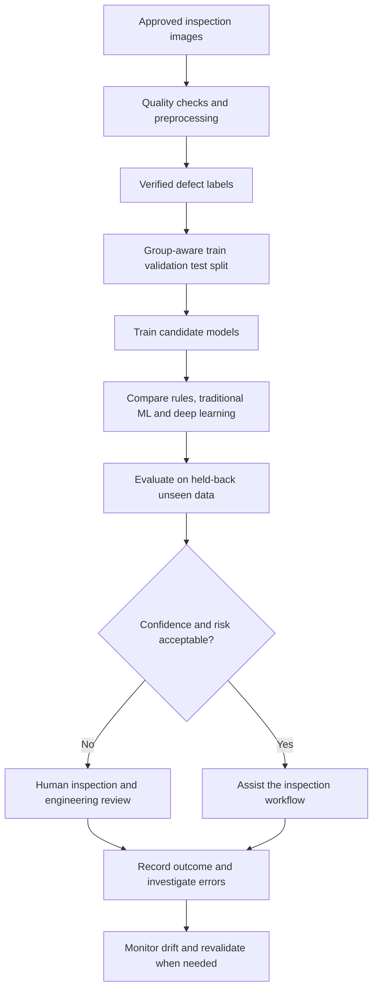

# Final Challenge – Engineering Case Study

## Title: Deep Learning for Semiconductor Surface-Defect Inspection

**Status of this case study:** This is a proposed learning case study, not a claim that I deployed a model in a semiconductor factory. It describes a possible engineering workflow that would need real data and validation before use.

## 1. Engineering problem

During semiconductor manufacturing, inspection is used to identify visible defects on wafers or related surfaces. Manual inspection and conventional image-processing methods can be useful, but complex surface patterns, lighting variation and small defects can make consistent classification difficult. The proposed task is to classify an inspection image as `defect` or `no_defect`, with more detailed defect classes added only if reliable labels are available.

## 2. Input data and preparation

**Input:** permitted inspection images captured using a consistent and documented imaging process.

Preparation could include checking image quality, removing corrupt files, identifying duplicates, resizing images to the model's input dimensions, converting pixels to numerical tensors and normalising values. Each image needs a verified label from an agreed inspection process. Label definitions should be clear so different reviewers apply them consistently.

The dataset should include variation in relevant production conditions. If images from the same wafer, lot, tool or capture session are closely related, the data split should be designed to prevent related images from leaking across training and test sets.

## 3. Prediction

The model receives an image and returns a score for each supported class. A simple first version could return scores for `defect` and `no_defect`. A score is not a guaranteed truth. The system should use thresholds selected through validation and send uncertain or high-impact cases for human review.

## 4. Why consider deep learning?

Deep learning may be worth testing because image defects can have complex visual patterns. A neural network may learn useful visual features from labelled examples instead of relying entirely on manually written image rules. However, deep learning should be compared with simpler alternatives using the same carefully separated evaluation data.

| Method | Possible advantage | Possible limitation |
|---|---|---|
| Fixed image-processing rules | Simple, fast and easier to inspect. | Sensitive to lighting, thresholds and changes in appearance. |
| Traditional ML with engineered features | Can work with smaller datasets and selected measurements. | Requires useful features to be designed and validated. |
| Deep-learning image model | Can learn complex features from image examples. | May need more labelled data, compute, monitoring and explanation work. |

## 5. Evaluation on unseen data

The final evaluation should use a held-back test set that was not used to choose model settings. The split should reflect the intended use case—for example, testing on different lots or capture sessions where possible. Useful measures include confusion matrix, defect-class precision, defect-class recall and performance by defect type or operating condition. The team should also examine examples the model gets wrong, not just report one overall accuracy number.

## 6. Error types and consequences

- **False negative:** a real defect is classified as normal. A defect may pass inspection and affect downstream quality or reliability.
- **False positive:** a normal image is classified as defective. This can create unnecessary review, rework, scrap or delay.

The acceptable balance depends on the product, defect severity and manufacturing process. Thresholds should be set with engineering and quality teams, not selected only to maximise accuracy.

## 7. Human review and responsible use

A human inspector or qualified engineer should review uncertain cases and cases with serious consequences. The workflow should record model version, input conditions, prediction and review outcome. Performance should be monitored after deployment because cameras, tools, materials and processes can change. Confidential RTL, netlists, timing constraints, proprietary scripts or restricted manufacturing data should not be uploaded to a public repository.

## 8. Proposed workflow

## 9. Conclusion

Deep learning is a possible tool for semiconductor image inspection, especially when visual patterns are complex. It should not replace engineering judgement without evidence. The model must be compared with simpler methods, tested on representative unseen data, reviewed for false negatives and false positives, and used with a clear human-review process. This case study is a proposal; actual performance would have to be established through an authorised experiment.
