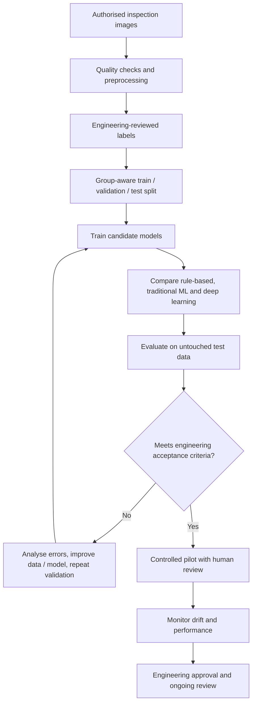

# Final Challenge — Engineering Case Study

## Proposed application: semiconductor inspection image classification

**Status:** This is a proposed student case study, not a claim about a deployed industrial system.

### 1. Engineering problem
During semiconductor manufacturing, inspection images may contain visual indications of defects. The proposed system aims to help screen images and prioritise those that may contain a defect for engineering review.

### 2. Required input data
- Inspection images captured under documented imaging conditions.
- Reliable labels from qualified inspection / engineering review.
- Metadata that may be needed to understand variation, such as wafer, lot, process step, tool, recipe and capture conditions, subject to data access and confidentiality rules.

Only authorised, non-confidential or appropriately approved data should be used in a learning project. Do not upload proprietary inspection images or restricted engineering information to public AI services.

### 3. Preparation and labels
Check image integrity, remove unusable records, standardise image dimensions and formats, and apply documented normalisation. Review duplicates and label consistency. Define classes clearly, for example `defect` and `no_defect`; if defect categories matter, use a well-defined multi-class scheme. Split data by meaningful groups (such as wafer, lot or capture session) to reduce leakage.

### 4. Model output
A neural network could output a score for each class, such as the estimated likelihood that an image belongs to the `defect` class. A threshold could route images to manual review. The output is a decision-support signal, not a final physical diagnosis.

### 5. Why deep learning may be suitable
Inspection images can contain complex visual patterns that are difficult to describe using a small set of hand-written rules. A deep-learning model may learn useful image representations directly from pixels, provided there is sufficient representative labelled data and suitable compute.

### 6. Alternatives worth testing
- **Rule-based:** useful for stable, clearly defined measurements or known signatures.
- **Traditional ML:** useful where engineered image features (such as texture, edges or shape measurements) capture the relevant information and labelled data is limited.
- **Deep learning:** worth evaluating when visual variation is complex and a sufficiently large, representative dataset is available.

A fair study should compare approaches on the same held-out data and use the same acceptance criteria.

### 7. Evaluation on unseen data
Keep a test set separate from training and validation. Where possible, reserve complete wafers, lots, tools or time periods for testing. Measure recall, precision, confusion matrix and class-wise performance. Pay special attention to false negatives (missed defects), and test performance across defect types, image quality and operating conditions.

### 8. Possible errors and consequences
- **False negative:** a defect image is classified as no defect; a defect could be missed by the screening system.
- **False positive:** a normal image is flagged; this can increase manual review workload and delay decisions.
- **Uncertain / out-of-distribution image:** the model may produce an unreliable score when conditions differ from training.

### 9. Human review and engineering judgement
Engineers should define defect classes and risk thresholds, review uncertain and high-risk cases, investigate failure patterns, approve changes and decide whether the model is appropriate for the process. The model should not replace established inspection controls without validation and formal approval.

## Proposed end-to-end diagram

## Limitations
This proposal does not establish that deep learning is better than alternatives or that a particular industrial line uses this exact workflow. Suitability depends on access to representative data, label quality, defect prevalence, the cost of errors, operational constraints and independent validation.
