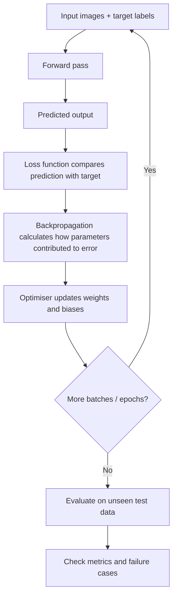

# Mission 4 — How Does a Neural Network Learn?

## Training flowchart

## The learning cycle
1. **Forward pass:** input values move through the network using its current weights and biases. The network produces a prediction.
2. **Loss function:** compares the prediction with the correct target label. Loss is a numerical measure of how far the prediction is from the target under the selected loss function. Lower loss generally means a better fit to the training target, but it does not by itself prove good real-world performance.
3. **Backpropagation:** calculates gradients that indicate how changing parameters would affect the loss.
4. **Optimisation:** an optimiser uses those gradients to update weights and biases, usually in a direction intended to reduce loss.
5. **Epoch:** one complete pass through the training dataset. Training commonly uses smaller batches, so many parameter updates can occur within an epoch.
6. **Repeated training:** forward pass, loss calculation, backpropagation and parameter updates repeat over batches and epochs.
7. **Evaluation:** after model development, measure performance on data not used to fit or tune the model.

## Training versus inference
- **Training:** the model uses labelled examples, calculates loss and updates parameters.
- **Inference:** the trained model receives a new input and produces a prediction. Parameters are not updated during ordinary inference.

## Generalisation, overfitting and incorrect labels
**Generalisation** means performing usefully on new examples from the intended operating environment. A model that performs very well on training images but poorly on new images may be overfitting, or the new data may differ from the training data (data shift). It may have memorised training-specific details rather than learning robust defect patterns.

If training labels are wrong, the model receives incorrect learning targets. It may learn the wrong associations, and its measured training performance may be misleading. Label review and independent evaluation are important.

## Evaluation
For defect detection, examine:
- Confusion matrix: true positives, false positives, true negatives and false negatives.
- **Recall:** among actual defect images, how many did the model detect?
- **Precision:** among images predicted as defect, how many were actually defects?
- Accuracy, where class balance makes it meaningful.
- Performance by defect category, wafer / lot, capture condition and image quality.
- False-negative and false-positive consequences.

The acceptable operating threshold depends on engineering risk. A missed defect and an unnecessary review do not necessarily have equal cost.
