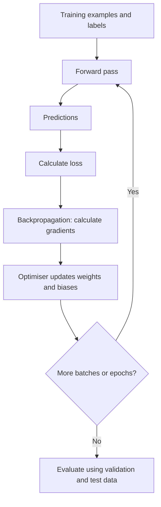

# Mission 4 – How Neural Networks Learn

## 1. Learning cycle

1. **Forward pass:** input data moves through the network to produce a prediction.
2. **Loss calculation:** a loss function compares the prediction with the correct training label. A larger loss generally means a worse prediction according to that function.
3. **Backpropagation:** the training process calculates how the loss changes with respect to the model's parameters (weights and biases).
4. **Optimisation:** an optimiser uses these gradients to update the parameters, aiming to reduce loss.
5. **Repeat:** the process runs over many examples and training iterations.

## 2. Important terms

- **Epoch:** one complete pass through the training dataset.
- **Batch:** a group of training examples processed together before an update (depending on the training setup).
- **Training:** the stage where model parameters are learned from training examples.
- **Inference:** using a trained model to produce predictions for new input data; the model is not normally updating its weights during ordinary inference.
- **Generalisation:** the ability to perform well on new, unseen examples, not just the examples used during training.

## 3. Training vs inference

| Training | Inference |
|---|---|
| Uses training examples and labels. | Uses new input data to make predictions. |
| Calculates loss and updates weights. | Normally keeps learned weights fixed. |
| Repeats over batches and epochs. | Runs when a prediction is needed. |
| Goal is to learn useful patterns. | Goal is to apply learned patterns. |

## 4. Overfitting and generalisation

Overfitting happens when a model learns the training examples too closely, including noise or accidental details. Training performance may be very good while performance on unseen data is poor. Validation data helps identify this problem. A final test set gives a more independent estimate of performance.

Ways to reduce overfitting can include collecting more representative data, using data augmentation where appropriate, reducing model complexity, regularisation and early stopping. These methods must be selected and evaluated for the particular task.

## 5. Why errors matter

For a defect-inspection task:

- **False negative:** a defective item is predicted as normal. This may allow a defect to pass inspection.
- **False positive:** a normal item is predicted as defective. This may cause unnecessary reinspection, scrap or production delay.

Accuracy alone may hide poor performance on a rare defect class. Precision and recall can provide additional information:

- `Precision = TP / (TP + FP)`
- `Recall = TP / (TP + FN)`

Here, TP means true positives, FP false positives and FN false negatives. The appropriate balance depends on the cost and safety impact of each error.
