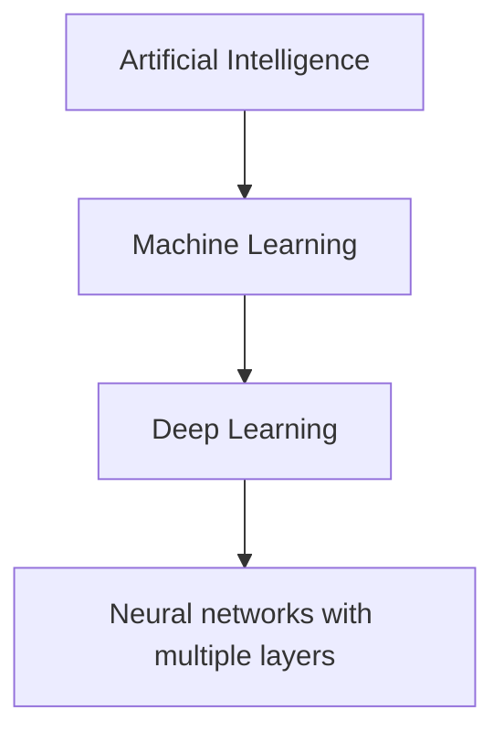

# Mission 2 – Machine Learning vs Deep Learning

## 1. Relationship between AI, ML and DL

Artificial intelligence (AI) is the broad area of building systems that perform tasks associated with intelligent behaviour. Machine learning (ML) is a part of AI in which a system learns patterns from data. Deep learning (DL) is a part of ML that uses neural networks with multiple processing layers.

## 2. Three approaches

| Approach | How it works | Example | Main limitation |
|---|---|---|---|
| Rule-based system | A person writes explicit rules, such as `if brightness > threshold`. | Flag a pixel region if its measured brightness crosses a fixed limit. | Rules may fail when lighting, products or conditions change. |
| Traditional machine learning | A person often designs useful input features; an algorithm learns how to combine them. | Use measured size, shape and contrast features to classify an object. | Performance depends on feature quality and may require manual feature design. |
| Deep learning | A multi-layer neural network learns useful representations from examples. | Learn visual patterns directly from labelled inspection images. | Often needs substantial representative data, computing resources and careful evaluation. |

## 3. Simple examples

- **Rule-based:** an email system blocks a message if it contains a particular manually listed phrase.
- **Traditional ML:** a spam classifier learns from features such as word frequencies, sender information and message length.
- **Deep learning:** a neural network learns complex patterns from text or image data, depending on its architecture and training data.

## 4. Why use deep learning?

Deep learning can be useful when the input is complex, such as images, audio or natural language, and it is difficult to write reliable rules or hand-design all useful features. In image inspection, a model may learn combinations of edges, textures and shapes that help distinguish normal surfaces from defects.

## 5. Limitations

Deep learning is not automatically the best choice. It can require many labelled examples, significant computing resources and careful monitoring. It can make mistakes, learn unwanted patterns in the data, and perform poorly when real-world conditions differ from training conditions. A simpler rule-based or traditional ML method may be easier to explain, cheaper to run and sufficient for a narrowly defined task.

**Conclusion:** choose the method based on the problem, data, cost, reliability and consequences of mistakes—not because deep learning is newer.
