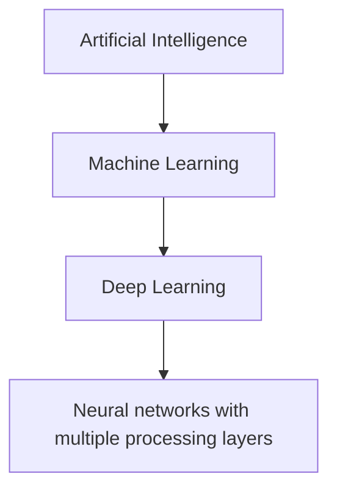

# Mission 2 — What Makes Deep Learning Different?

## Relationship between AI, ML, DL and neural networks

- **Artificial intelligence (AI):** the broad field of building systems that perform tasks associated with intelligent behaviour.
- **Machine learning (ML):** a part of AI in which a system learns patterns from data rather than relying only on hand-written rules.
- **Deep learning (DL):** a part of ML that uses neural networks with multiple layers to learn representations from data.
- **Neural network:** a model made of connected computational units that transform numerical inputs.

## Comparison

| Approach | How it works | Example problem | Example | Limitation |
|---|---|---|---|---|
| Rule-based system | Engineers write explicit conditions and thresholds. | Flag an image if a known measurement exceeds a fixed limit. | If measured scratch width > defined threshold, flag for review. | Brittle when appearance, lighting or defect types vary; rules need manual maintenance. |
| Traditional ML | Engineers often define or extract features; an algorithm learns a relationship between features and labels. | Classify inspection images using measured texture, edge or shape features. | Extract image features, then train a decision tree or support-vector machine. | Feature engineering can be difficult; performance depends on selected features and data. |
| Deep learning | A multi-layer neural network learns useful representations from numerical data during training. | Classify complex inspection images with varied visual patterns. | A CNN learns image features and predicts defect / no defect. | Often needs substantial representative labelled data and compute; can be hard to interpret and can fail under data shift. |

## Semiconductor example
For inspection images, a simple rule might detect a large dark region. A traditional ML approach might calculate edge density, texture and region size before classification. A deep-learning approach can learn layered visual features from pixel data. None is automatically best: compare them using the same independent test data and engineering acceptance criteria.

## Example outside semiconductors
A speech-recognition system converts audio into numerical features and predicts words. Deep learning can learn complex patterns in audio, but simpler methods may be suitable for constrained tasks with limited variation.

## Does adding more layers always improve accuracy?
No. Extra layers increase model capacity and may help represent complex patterns, but they can also increase training time, data requirements and overfitting risk. Performance must be checked on validation data and finally on untouched test data.

## When simpler approaches may be better
- The problem has a small number of stable, explainable rules.
- There is little labelled data.
- A simple model already meets the required accuracy, latency and reliability.
- Interpretability, low compute cost or ease of maintenance is especially important.

**Conclusion:** choose the simplest method that meets the engineering requirements with verified evidence.
