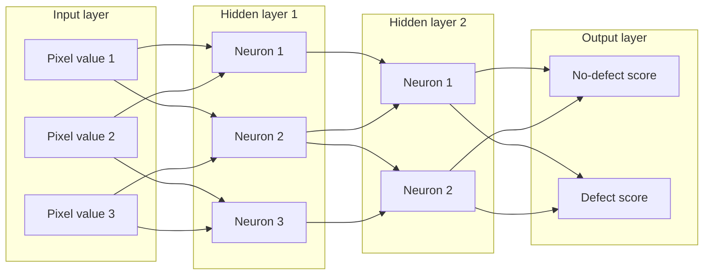

# Mission 3 – Opening a Neural Network

## 1. Main components

- **Input layer:** receives the numerical input. For an image, the input values can be pixel values.
- **Hidden layers:** process information between input and output. Each neuron receives values from earlier neurons and calculates a new value.
- **Output layer:** produces the model's result, such as class scores or probabilities.
- **Weights:** numerical values that control the strength of connections between neurons.
- **Biases:** additional learned values that shift a neuron's calculation.
- **Activation function:** transforms a neuron's weighted input. Examples include ReLU and sigmoid.

A simplified neuron calculation is:

`z = w1*x1 + w2*x2 + ... + wn*xn + b`

`output = activation(z)`

Here, `x` values are inputs, `w` values are weights, and `b` is the bias.

## 2. Labelled network diagram

The arrows represent connections. In a real network, each connection has a learned weight. The diagram is simplified and does not show every possible connection.

## 3. Trace one inspection image

1. A prepared inspection image is converted into numerical pixel values.
2. Those values enter the input layer.
3. Hidden-layer neurons combine incoming values using weights and biases, then apply activation functions.
4. Later layers process the resulting values.
5. The output layer produces scores for the available classes.
6. A decision rule may select the class with the highest score, while a production system may also use confidence thresholds and human review.

For illustration only, suppose the output scores are `no_defect = 0.20` and `defect = 0.80`. The larger score favours the defect class. These numbers are examples, not results from a real experiment or trained model. A prediction is not proof; it must be evaluated against verified labels and the real inspection requirements.
