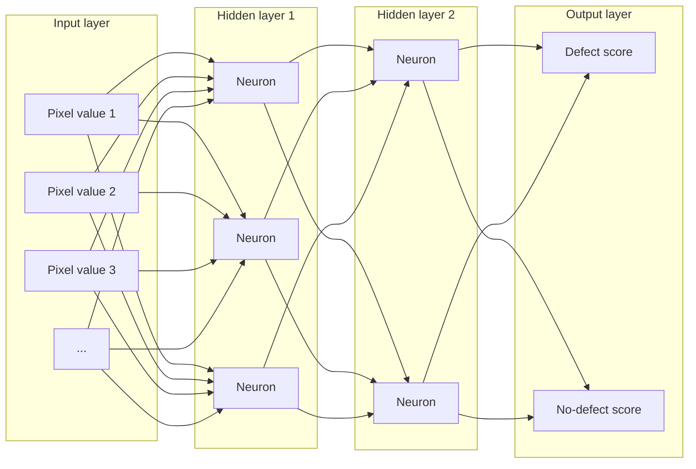

# Mission 3 — Open the Neural Network

## Labelled neural-network diagram

*Conceptual diagram only: a real image model may use convolution, pooling or other operations, and can contain many more units.*

## What each component does
- **Input layer:** receives numerical image values (pixels arranged in a tensor).
- **Hidden layers:** transform information to learn increasingly useful patterns.
- **Output layer:** produces scores or probabilities for the target classes.
- **Neurons / nodes:** computational units that combine incoming values and apply an activation function.
- **Weights:** learned values that control the influence of incoming signals.
- **Biases:** learned offsets that help shift a neuron's response.
- **Activation functions:** introduce non-linearity, allowing the network to learn relationships more complex than a simple linear transformation.

## Trace one inspection image
1. A prepared inspection image is converted to numerical pixel values.
2. The input layer receives those values.
3. Hidden layers combine them using weights and biases, then apply activation functions.
4. The output layer produces class scores, for example `defect: 0.82` and `no_defect: 0.18`.
5. The system may flag the image for review according to a threshold chosen and validated by engineers.

The score is not automatic proof of a physical defect. The prediction may be wrong because of poor image quality, missing training examples, incorrect labels or changes in inspection conditions. A human or a separate validated inspection method may be needed to confirm it.
