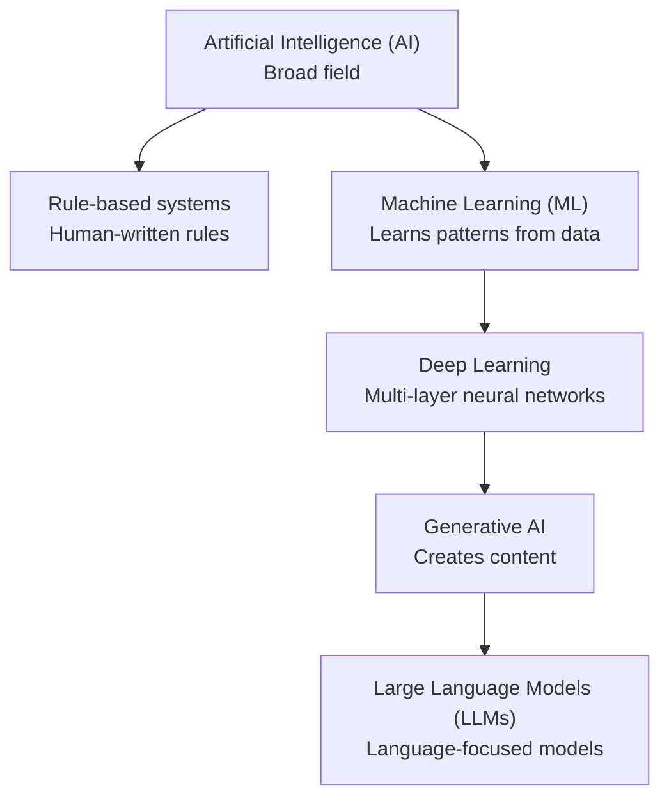

# Mission 1 — Build the AI and ML Landscape

## 1. Concept map

> **Note:** This is a simplified map, not a strict hierarchy in every case. Generative AI can use different architectures, and not all generative AI is deep learning or an LLM.

## 2. AI, rule-based programming and ML

| Approach | How it works | What people specify | Example |
|---|---|---|---|
| Rule-based program | Follows written conditions and instructions | Rules and expected behaviour | If temperature exceeds a limit, raise an alarm |
| Machine learning | Learns patterns from examples | Goal, training data, labels or feedback, and evaluation method | Predict timing pass/fail from historical design runs |
| Artificial intelligence | Broad field that includes several ways to build intelligent behaviour | Depends on the technique | A rule-based expert system or an ML-based detector |

## 3. Five distinctions

1. **AI vs ML:** AI is the broad field; ML is one family of methods within it.
2. **Rule-based vs ML:** A rule-based program follows rules written by a person. An ML model learns patterns from examples.
3. **ML vs deep learning:** Deep learning is a subset of ML that uses neural networks with multiple layers.
4. **Generative AI vs LLM:** Generative AI creates content such as text, images or code. An LLM is a model specialised in language and may be used in a generative system.
5. **Automation vs AI:** Automation means a task runs with less manual effort. A fixed script can automate a task without learning or AI. AI does not always require ML because rule-based AI systems also exist.

## 4. What is explicitly programmed and what is learned?

- In a rule-based system, the programmer explicitly writes the decision rules.
- In ML, developers still write the software and define the training process, but the model's useful parameters are learned from data.
- An ML model does not automatically understand a problem like a human. Its output depends on its training data, design and evaluation.

## 5. Three classified examples

| Example | Classification | Reason |
|---|---|---|
| A script renames every file in a folder using a fixed pattern | Conventional automation / rule-based programming | It follows instructions and does not learn from examples |
| A model predicts whether a design run will pass timing using past run data | ML, likely supervised classification | Historical examples include the pass/fail target |
| A chatbot generates a paragraph in response to a question | Generative AI; it may use an LLM | Its output is newly generated text based on learned language patterns |

## Sources
- Google, [Introduction to Machine Learning](https://developers.google.com/machine-learning/intro-to-ml/what-is-ml)
- Google, [Machine Learning](https://developers.google.com/machine-learning)
- Google, [Problem Framing](https://developers.google.com/machine-learning/problem-framing/problem-framing)
