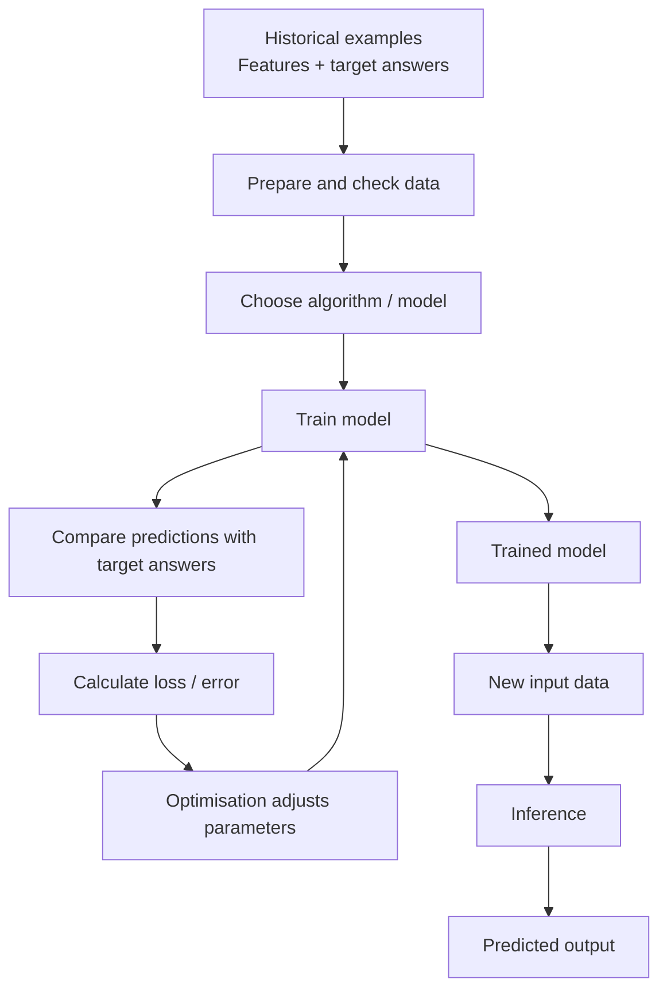

# Mission 5 — Understand the Anatomy of an ML Model

## 1. Key terms

- **Algorithm:** The method used to learn from training examples.
- **Model:** The learned relationship used to make predictions.
- **Parameters:** Values adjusted during training to fit patterns.
- **Training:** Using examples to learn model parameters.
- **Inference:** Using a trained model to produce an output for new input data.
- **Loss/error:** A measure of how far predictions are from target answers.
- **Optimisation:** The process used to adjust parameters to reduce loss.

## 2. Training-to-inference flow diagram

During training, predictions can be compared with known targets. A loss function measures error in a defined way, and an optimisation method updates parameters to reduce that loss. The exact details depend on the ML method.

## 3. Linear regression

Linear regression learns a relationship between input features and a numerical target. For example, it might learn how historical design measurements relate to delay. It can then estimate delay for a new design.

A simple one-feature form is:

`predicted delay = weight × input feature + bias`

The weight and bias are learned from training examples. Real design problems may require multiple features and more complex models. A prediction is an estimate, not a replacement for sign-off timing analysis.

## Sources
- Google, [What is Machine Learning?](https://developers.google.com/machine-learning/intro-to-ml/what-is-ml)
- Google, [Linear Regression](https://developers.google.com/machine-learning/crash-course/linear-regression)
