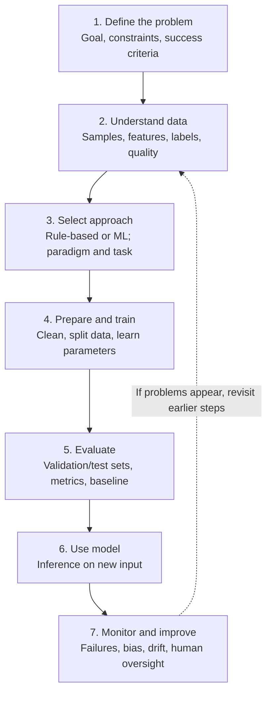

# ML Foundations Map — Lifecycle

## Where the concepts fit

- **Learning paradigms:** supervised, unsupervised, reinforcement and self-supervised.
- **Task types:** classification, regression, clustering, anomaly detection, dimensionality reduction and recommendation/ranking.
- **Possible failure points:** incorrect labels, unrepresentative data, data leakage, overfitting and changing real-world data.
- **Semiconductor application:** early estimation of timing slack from historical Physical Design runs. This is an estimate to investigate, not final sign-off.
