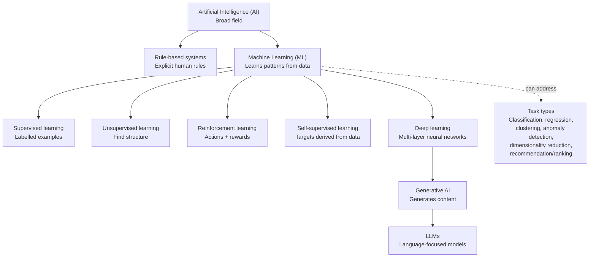

# AI / ML Mental Map

## Remember

- Learning paradigms describe **how a model learns**.
- Task types describe **what output or problem is required**.
- Generative AI describes systems that generate content; LLMs focus on language. This is a simplified conceptual map, not a strict hierarchy in every case.

## Semiconductor example

**Proposed Physical Design application:** Use historical design-run features to estimate timing slack.

- Learning paradigm: supervised learning, if historical target values are available.
- Task type: regression.
- Output: estimated timing slack.
- Limitation: validate on unseen designs and confirm final timing with the approved EDA flow.
